# ambientCG: Asphalt materials

**21 assets from [ambientCG](https://ambientcg.com), dedicated to the public domain under [CC0](https://docs.ambientcg.com/license/).** Use them in any game, free or paid, and change them however you like; no credit is needed.

PBR materials as 1K and 2K JPG maps (colour, normal GL and DX, roughness, AO, displacement), one folder per resolution. 874.5 MB in all.

This is a copy kept by [zuujis-cc0](https://github.com/zuujis-cc0) so game makers can take single files from GitHub. It is not made by or affiliated with ambientCG: the originals, often in more formats and higher resolutions, are on [ambientcg.com](https://ambientcg.com). If they help you, consider [supporting ambientCG](https://www.patreon.com/ambientCG).

Every file is listed in [MANIFEST.tsv](MANIFEST.tsv) with its size and SHA-256. More free assets: [the Zuujis collection](https://github.com/zuujis-cc0/free-game-assets#readme).

| | | | |
| :-: | :-: | :-: | :-: |
| <a href="Asphalt023L">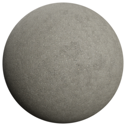</a> <b><a href="Asphalt023L">Asphalt 023 L</a></b> by ambientCG · <a href="https://ambientcg.com/a/Asphalt023L">source</a> | <a href="Asphalt023S">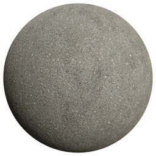</a> <b><a href="Asphalt023S">Asphalt 023 S</a></b> by ambientCG · <a href="https://ambientcg.com/a/Asphalt023S">source</a> | <a href="Asphalt024A">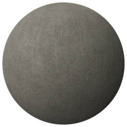</a> <b><a href="Asphalt024A">Asphalt 024 A</a></b> by ambientCG · <a href="https://ambientcg.com/a/Asphalt024A">source</a> | <a href="Asphalt024B">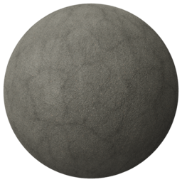</a> <b><a href="Asphalt024B">Asphalt 024 B</a></b> by ambientCG · <a href="https://ambientcg.com/a/Asphalt024B">source</a> |
| <a href="Asphalt024C">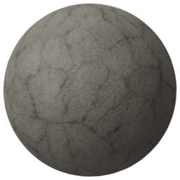</a> <b><a href="Asphalt024C">Asphalt 024 C</a></b> by ambientCG · <a href="https://ambientcg.com/a/Asphalt024C">source</a> | <a href="Asphalt025A">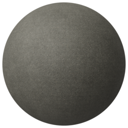</a> <b><a href="Asphalt025A">Asphalt 025 A</a></b> by ambientCG · <a href="https://ambientcg.com/a/Asphalt025A">source</a> | <a href="Asphalt025B">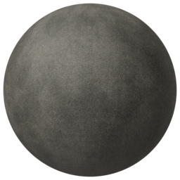</a> <b><a href="Asphalt025B">Asphalt 025 B</a></b> by ambientCG · <a href="https://ambientcg.com/a/Asphalt025B">source</a> | <a href="Asphalt025C">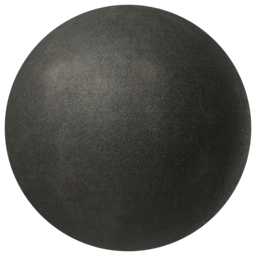</a> <b><a href="Asphalt025C">Asphalt 025 C</a></b> by ambientCG · <a href="https://ambientcg.com/a/Asphalt025C">source</a> |
| <a href="Asphalt026A">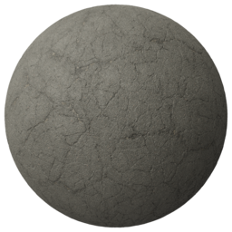</a> <b><a href="Asphalt026A">Asphalt 026 A</a></b> by ambientCG · <a href="https://ambientcg.com/a/Asphalt026A">source</a> | <a href="Asphalt026B">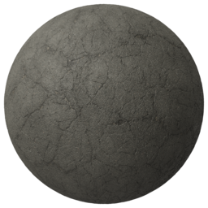</a> <b><a href="Asphalt026B">Asphalt 026 B</a></b> by ambientCG · <a href="https://ambientcg.com/a/Asphalt026B">source</a> | <a href="Asphalt026C">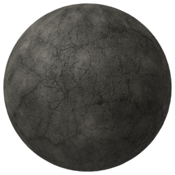</a> <b><a href="Asphalt026C">Asphalt 026 C</a></b> by ambientCG · <a href="https://ambientcg.com/a/Asphalt026C">source</a> | <a href="Asphalt027A">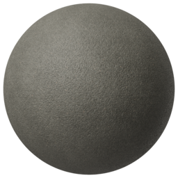</a> <b><a href="Asphalt027A">Asphalt 027 A</a></b> by ambientCG · <a href="https://ambientcg.com/a/Asphalt027A">source</a> |
| <a href="Asphalt027B">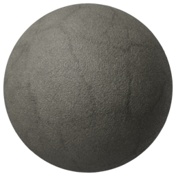</a> <b><a href="Asphalt027B">Asphalt 027 B</a></b> by ambientCG · <a href="https://ambientcg.com/a/Asphalt027B">source</a> | <a href="Asphalt027C">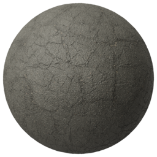</a> <b><a href="Asphalt027C">Asphalt 027 C</a></b> by ambientCG · <a href="https://ambientcg.com/a/Asphalt027C">source</a> | <a href="Asphalt028A">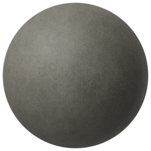</a> <b><a href="Asphalt028A">Asphalt 028 A</a></b> by ambientCG · <a href="https://ambientcg.com/a/Asphalt028A">source</a> | <a href="Asphalt028B">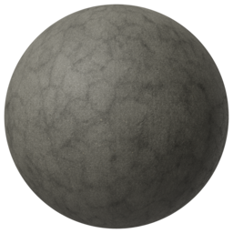</a> <b><a href="Asphalt028B">Asphalt 028 B</a></b> by ambientCG · <a href="https://ambientcg.com/a/Asphalt028B">source</a> |
| <a href="Asphalt028C">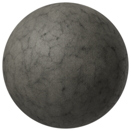</a> <b><a href="Asphalt028C">Asphalt 028 C</a></b> by ambientCG · <a href="https://ambientcg.com/a/Asphalt028C">source</a> | <a href="Asphalt029A">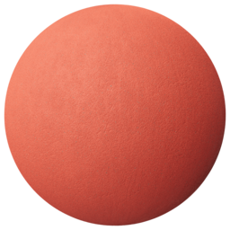</a> <b><a href="Asphalt029A">Asphalt 029 A</a></b> by ambientCG · <a href="https://ambientcg.com/a/Asphalt029A">source</a> | <a href="Asphalt029B">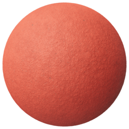</a> <b><a href="Asphalt029B">Asphalt 029 B</a></b> by ambientCG · <a href="https://ambientcg.com/a/Asphalt029B">source</a> | <a href="Asphalt030">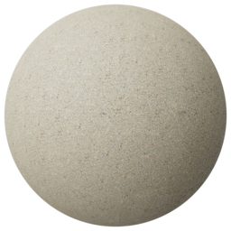</a> <b><a href="Asphalt030">Asphalt 030</a></b> by ambientCG · <a href="https://ambientcg.com/a/Asphalt030">source</a> |
| <a href="Asphalt031">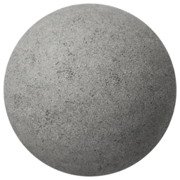</a> <b><a href="Asphalt031">Asphalt 031</a></b> by ambientCG · <a href="https://ambientcg.com/a/Asphalt031">source</a> |  |  |  |

---

Kept up to date by this repository's own [update workflow](.github/workflows/update.yml), with code and plan from [cc0-mirror](https://github.com/zuujis-cc0/cc0-mirror). Something wrong? [Open an issue there](https://github.com/zuujis-cc0/cc0-mirror/issues/new) or use the [private report form](https://games.zuujis.com/report).
